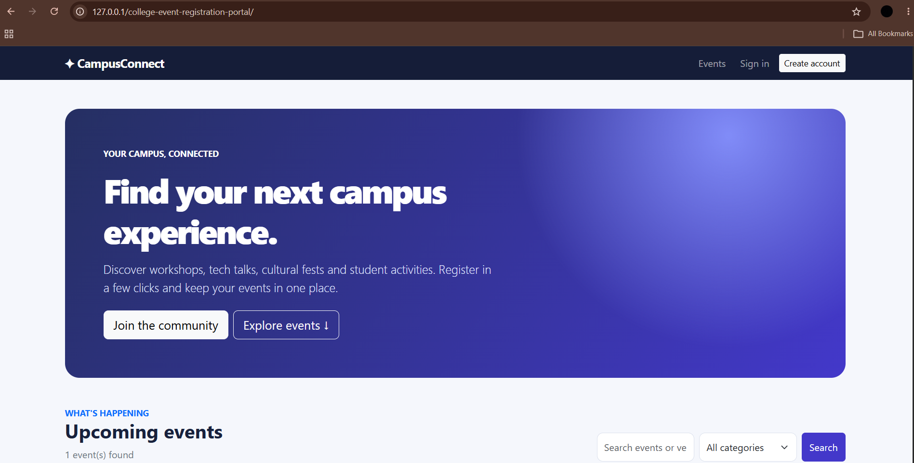
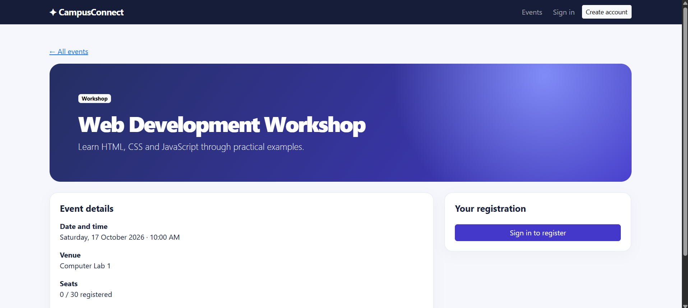
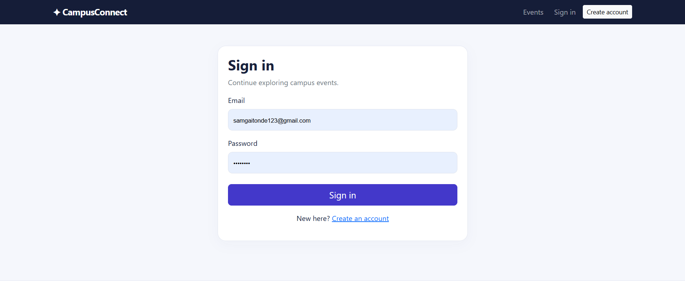
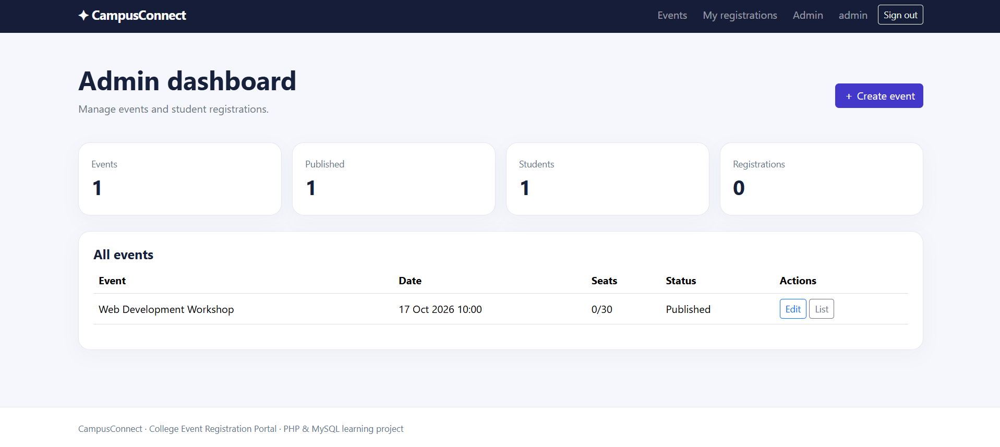

# CampusConnect — College Event Registration Portal

A PHP and MySQL web application for publishing college events and managing student registrations. Built as a beginner-to-intermediate web development portfolio project.

## Features

- Responsive event discovery, keyword search, and category filtering
- Student sign-up and sign-in with password hashing
- Event details, capacity tracking, and student registration
- Cancel registrations and view personal registration history
- Admin dashboard to create and edit events and view participants
- Draft, published, and cancelled event statuses
- PDO prepared statements, output escaping, CSRF tokens, validation, and session ID regeneration
- MySQL foreign keys and unique user/event registrations
- Responsive Bootstrap interface

## Stack

PHP 8+, MySQL/MariaDB, PDO, HTML, CSS, Bootstrap 5, JavaScript, Apache/XAMPP.

## Local Setup (Windows/XAMPP)

1. Extract the project to `C:\xampp\htdocs\college-event-registration-portal\`.
2. Start Apache and MySQL in XAMPP.
3. Open [phpMyAdmin](http://127.0.0.1/phpmyadmin/) and import `database/schema.sql`.
4. Copy `config.example.php` to `config.php`. Set the database host, port, database name, username, and password to match your local setup. The example uses port `3307`, database `college_events`, user `root`, and a blank password; change these if needed. The local `config.php` is ignored by Git. Never use a blank root password on a public server.
5. Open [http://localhost/college-event-registration-portal/](http://localhost/college-event-registration-portal/).

## Create the First Administrator (Local Only)

1. Open `http://localhost/college-event-registration-portal/admin/create-admin.php` if the one-time administrator creation utility is present.
2. Create an administrator account with a strong password of at least 12 characters.
3. Sign in and open **Admin → Create Event** to publish an event.
4. Immediately delete `admin/create-admin.php` after creating the administrator. This utility must not remain accessible on a public deployment.

## Suggested Test Plan

1. Register a student account and sign in.
2. Create and publish an event as an administrator.
3. Register for the event as a student and confirm the seat count changes.
4. Try registering twice and confirm duplicate registration is prevented.
5. Cancel the registration and confirm the seat count is restored.
6. Test event capacity, invalid fields, and administrator-only access.

## Screenshots

### Homepage

### Event Details

### Student Registration

### Admin Dashboard

## Limitations

This is a learning project and is not production-ready. Before real deployment, add automated tests, rate limiting, email verification, password reset, hardened session and cookie settings, a security review, and backups. Never deploy with default credentials.

## Future Improvements

- GitHub Actions CI
- Pagination and CSV export
- Email confirmations
- Docker Compose
- Deployment automation and infrastructure as code

## License

MIT. See [LICENSE](LICENSE).